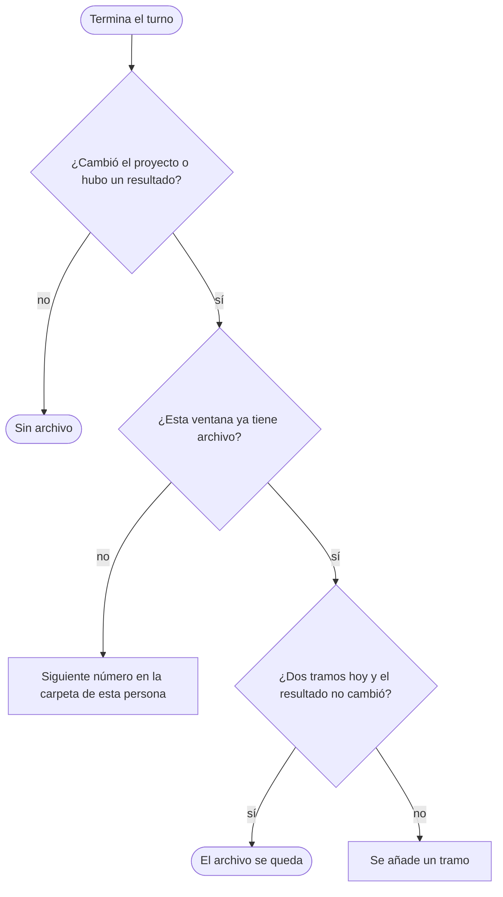

<p align="right">Idioma:&emsp;<a href="README.md" style="vertical-align:middle"></a> </p>

# Cronología (`plugin-chronology`)

Escribe un párrafo por ventana de chat sobre lo que se intentó en este proyecto y si funcionó. La nota es del proyecto donde se instala el plugin. Un intento que no llegó a commit se queda en la nota.

La pieza vive en `skills/record-chronology/references/note.md`. El resultado es Markdown en `adrenaline/chronology/<persona>/`.

Las instrucciones están en inglés. El párrafo que guarda el plugin sigue el idioma del pedido.

## Automático

En Cursor la nota se escribe al final de un turno que cambió el proyecto o dejó un resultado. No escribes un comando. Una pregunta sin resultado no crea archivo. El chat no muestra la nota, el archivo ni una línea de estado. El hook escribe el archivo desde un bloque que el agente deja en su pensamiento. Una edición en esa carpeta se rechaza, así el chat no muestra ese diff.



Una ventana que sigue abierta conserva el mismo archivo. Se añade un tramo cuando el último es de un día UTC anterior, o cuando el resultado cambió, y este día UTC todavía tiene menos de dos tramos. Al cerrar la ventana se añade `Closed:` y no se redacta el párrafo.

El mismo número en dos equipos de una persona, antes de sincronizar, se arregla con el id de ventana que va dentro del archivo. La nota cuyo id no coincide con ese número pasa al siguiente libre de esa persona.

## /chronology-note

Escribe o actualiza la nota de esta ventana. En Cursor la regla lo hace al final de un turno que califica. El comando es la misma pieza cuando la pides, y es el camino portable en Claude Code: `/plugin-chronology:chronology-note`.

La carpeta de la persona sale de `git config user.name`. `Ana López` es `ana-lopez`. Si ese nombre falta, no se inventa carpeta.

## /chronology-help

Imprime el catálogo. No escribe una nota.

## Para quién es

Quien quiere que la siguiente persona, o la siguiente ventana, vea lo que ya se intentó en este proyecto. La foto vigente del proyecto se queda en `plugin-project-context`. Una decisión que tiene que seguir vigente se queda en `plugin-software-architect`. Las señales del sistema en ejecución se quedan en `plugin-observability`. Este plugin no copia sus skills.

## Qué incluye

Portable, para cualquier agente que siga [Agent Skills](https://agentskills.io/specification):

- Un skill, `record-chronology`. Lleva la carpeta de salida y las restricciones de la nota, para un agente que no carga rules.

Cursor y Claude Code:

- Dos commands: `/chronology-help` y `/chronology-note`. En Cursor, `/chronology-note`. En Claude Code, `/plugin-chronology:chronology-note`.

- Un agente, `plugin-chronology`. Sigue los skills de este plugin y dice cuándo pedir otro plugin. El método se queda en el skill.

Solo Cursor:

- Rule `output-folder`, que deja cada archivo en `adrenaline/chronology/`.
- Rule `chronology-note`, que escribe la nota en el mismo turno, sin esperar a que se pida.
- Hooks en `hooks/cursor-hooks.json`. `sessionStart` pasa el id de la ventana y pide dejar el bloque en el pensamiento. `afterAgentThought` escribe la nota desde ese bloque, así el chat no muestra el archivo. `preToolUse` rechaza una edición dentro de la carpeta de cronología. `afterFileEdit` recuerda una edición en esta máquina. `stop` se queda callado. `sessionEnd` añade `Closed:`.

Solo Claude Code:

- Hook `SessionStart` en `hooks/claude-hooks.json`. Pasa el id de la ventana. El sello de cierre no corre. La escritura portable es `/chronology-note`.

Los hooks necesitan PowerShell. Donde no está, la escritura es `/chronology-note`.

## Instalación

En Cursor, instala el plugin desde este repositorio en Customize.

En Claude Code, este repositorio es también un marketplace:

```text
claude plugin marketplace add ADRenaline-Suite/plugin-chronology
claude plugin install plugin-chronology@plugin-chronology
```

Para probar una copia local sin instalarla, arranca Claude Code con `claude --plugin-dir <ruta de este repositorio>`.

En otro agente, instala el skill con el mecanismo de ese agente. Por ejemplo:

```text
gh skill install ADRenaline-Suite/plugin-chronology
```

## Salida

`adrenaline/chronology/` en la raíz del proyecto. `.cursor/adrenaline.json` puede dar otra ruta relativa en `outputDirs["plugin-chronology"]`. Un `chronology/` que ya exista en la raíz sigue recibiendo los archivos.

```text
adrenaline/chronology/
├── ORIGIN.json
├── STATUS.md
├── ana/
│   └── 001-chronology-login.md
└── luis/
    └── 001-chronology-cart.md
```

`ORIGIN.json` nombra la carpeta. No es un archivo `<NNN>` y no tiene fila en `STATUS.md`.
