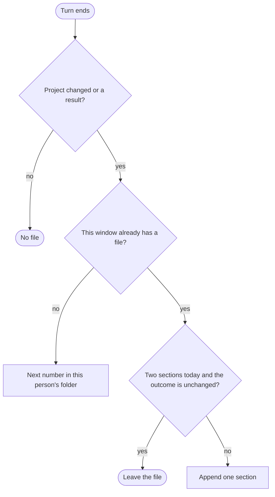

<p align="right">Language:&emsp; <a href="README.es.md" style="vertical-align:middle"></a></p>

# Chronology (`plugin-chronology`)

Writes one paragraph per chat window about what was tried in this project and whether it worked. The note belongs to the project where the plugin is installed. An attempt that never became a commit stays in the note.

The piece lives in `skills/record-chronology/references/note.md`. The result is Markdown in `adrenaline/chronology/<person>/`.

The instructions are in English. The paragraph the plugin saves follows the language of the request.

## Automatic

In Cursor the note is written at the end of a turn that changed the project or reached a result. You do not type a command. A question with no result writes nothing.



A window that stays open keeps the same file. A new section is added when the last one is from a previous UTC day, or when the outcome changed, and this UTC day still has fewer than two sections. Closing the window appends `Closed:` and does not write the paragraph.

The same number on two machines of one person, before they sync, is repaired by the window id inside the file. The note whose id does not match that number moves to the next free number of that person.

## /chronology-note

Writes or updates the note for this window. In Cursor the rule does this at the end of a qualifying turn. The command is the same piece when you ask for it, and it is the portable way in Claude Code: `/plugin-chronology:chronology-note`.

The person folder comes from `git config user.name`. `Ana López` is `ana-lopez`. When that name is missing, no folder is invented.

## /chronology-help

Prints the catalog. It does not write a note.

## Who it is for

Someone who wants the next person, or the next window, to see what was already tried in this project. The current picture of the project stays with `plugin-project-context`. A decision that must stay in force stays with `plugin-software-architect`. Runtime signals stay with `plugin-observability`. This plugin does not copy their skills.

## What it includes

Portable, for any agent that follows [Agent Skills](https://agentskills.io/specification):

- One skill, `record-chronology`. It carries the output folder and the note restrictions, for an agent that does not load rules.

Cursor and Claude Code:

- Two commands: `/chronology-help` and `/chronology-note`. In Cursor, `/chronology-note`. In Claude Code, `/plugin-chronology:chronology-note`.

Cursor only:

- Rule `output-folder`, which keeps every file in `adrenaline/chronology/`.
- Rule `chronology-note`, which writes the note in the same turn, without waiting to be asked.
- Hooks in `hooks/cursor-hooks.json`. `sessionStart` passes the window id. `afterFileEdit` remembers an edit on this machine. `stop` asks once when that edit has no note. `sessionEnd` appends `Closed:`.

Claude Code only:

- Hook `SessionStart` in `hooks/claude-hooks.json`. It passes the window id. The close stamp does not run. The portable write is `/chronology-note`.

The hooks need PowerShell. Where PowerShell is not available, `/chronology-note` is the write.

## Install

In Cursor, install the plugin from this repository in Customize.

In Claude Code, this repository is also a marketplace:

```text
claude plugin marketplace add ADRenaline-Suite/plugin-chronology
claude plugin install plugin-chronology@plugin-chronology
```

To try a local copy without installing it, start Claude Code with `claude --plugin-dir <path to this repository>`.

In another agent, install the skill with that agent's mechanism. For example:

```text
gh skill install ADRenaline-Suite/plugin-chronology
```

## Output

`adrenaline/chronology/` at the project root. `.cursor/adrenaline.json` can set another relative path under `outputDirs["plugin-chronology"]`. An existing `chronology/` at the project root keeps receiving files.

```text
adrenaline/chronology/
├── ORIGIN.json
├── STATUS.md
├── ana/
│   └── 001-chronology-login.md
└── luis/
    └── 001-chronology-cart.md
```

`ORIGIN.json` names the folder. It is not an `<NNN>` file and it has no row in `STATUS.md`.
